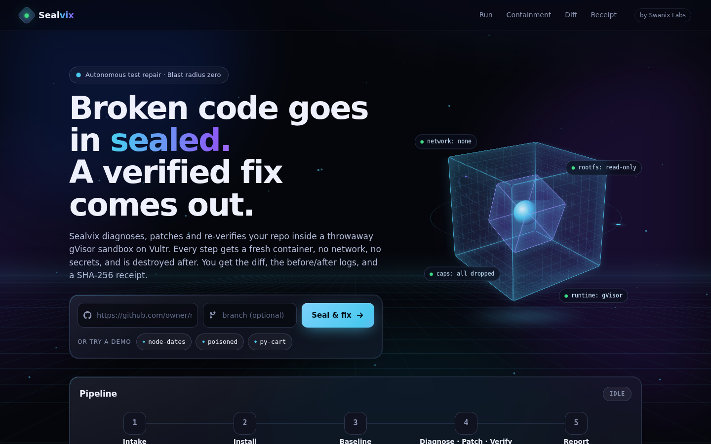
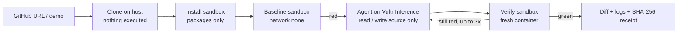
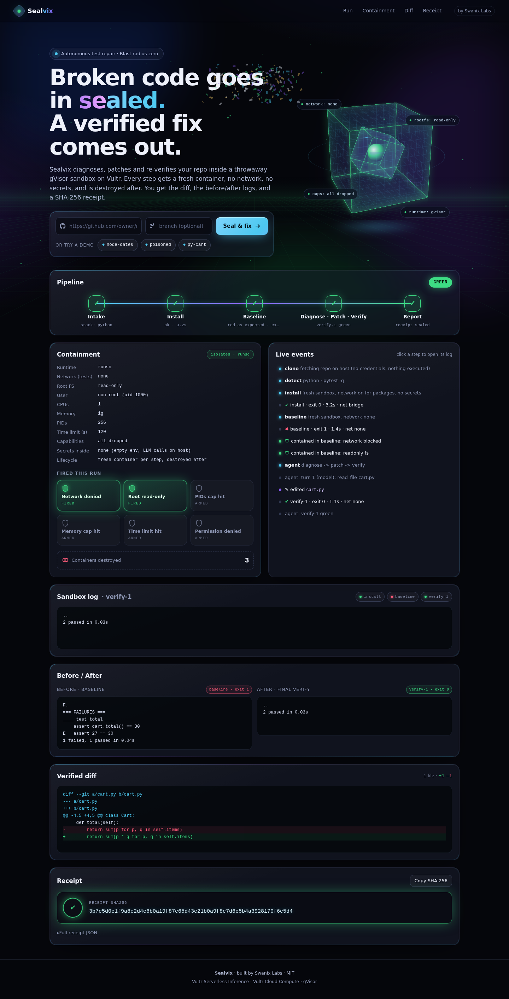

<p align="center"></p>

<p align="center">
<a href="https://65.20.75.55.sslip.io"></a>


</p>

<p align="center">
<a href="https://readme-typing-svg.demolab.com"></a>
</p>

<p align="center"></p>

# Sealvix

**Paste a repo with failing tests. Get back a verified fix, produced entirely inside a throwaway gVisor sandbox on Vultr.**

Built by Swanix Labs for the Vultr Agent Rush hackathon, Challenge 1: *Blast Radius Zero* (Pattern A, sandboxed code execution).

An auto-fixer that runs untrusted code with host access can wreck a machine, leak secrets or rewrite the tests to "pass".
Sealvix can't: every command runs in a fresh, locked-down container that is destroyed afterwards, the model
never gets a shell, and tests are read-only to the agent. Every run ends with a hashed receipt you can check.

## How it works

1. **Intake:** a public GitHub URL (or a built-in demo). The repo is cloned on the host with no credentials; nothing is executed there.
2. **Install:** fresh sandbox, network on only for package downloads, no secrets inside.
3. **Baseline:** fresh sandbox, `--network none`. Failing tests are recorded.
4. **Diagnose → patch → verify:** the model on Vultr Serverless Inference reads failures and source through a narrow toolbox, edits source files, and re-runs the suite in a new sandbox each time (up to 3 rounds).
5. **Report:** unified diff, before/after logs, which containment controls fired, and a SHA-256 receipt.

## Vultr services used

| Service | Role |
| --- | --- |
| **Vultr Serverless Inference** (`https://api.vultrinference.com/v1`, OpenAI-compatible) | The agent's brain: diagnosis, tool calls, patches. Primary model `glm-5.3`, fallback `deepseek-v4.1-flash-1017`. |
| **Vultr Cloud Compute** (Ubuntu 24.04, 2 vCPU / 4 GB) | Control plane: FastAPI app, job runner, live event stream, Docker + gVisor sandbox host, Caddy for HTTPS. |

## Pipeline at a glance



## Architecture

```
 Browser ──HTTPS──▶ Caddy ──▶ FastAPI (host, Vultr VM)
                                 │   ├── job runner (threads, 2 concurrent)
                                 │   ├── Toolbox: list/read/write source, run_tests   (tests read-only, path-confined)
                                 │   └── Agent loop ──HTTPS──▶ Vultr Serverless Inference   (API key stays on host)
                                 │
                                 └── docker run --runtime=runsc  (one container per step, --rm)
                                        gVisor user-space kernel
                                        --network none (tests) · --read-only root · non-root uid 1000
                                        --cap-drop ALL · no-new-privileges · 1 CPU · 1 GB · 256 PIDs · 120 s
                                        only /work (job copy) and /tmp writable · empty env
```

### Agent loop (`app/agent.py`)

- Runs on the host only. Calls `https://api.vultrinference.com/v1/chat/completions` with `httpx` and OpenAI-style tool calling;
  the key comes from `VULTR_INFERENCE_KEY` and never enters a sandbox or the event stream.
- Model `VULTR_MODEL` (default `glm-5.3`), automatic fallback to `VULTR_FALLBACK_MODEL` (default `deepseek-v4.1-flash-1017`)
  on HTTP 429, 5xx, timeouts or network errors.
- The first prompt holds the baseline failure output (trimmed to ~12k chars, tail kept) and the file list, marked as untrusted data.
  The system prompt asks for minimal source-only fixes, forbids test edits, and tells the model to ignore instructions found in repo text or test output.
- Tools: `list_files`, `read_file(path)`, `write_file(path, content)`, `run_tests`, `finish(summary)`, mapped 1:1 onto the Toolbox.
  The model never gets a shell.
- Limits: at most 3 `run_tests` rounds (each a fresh `--network none` sandbox) and 25 tool calls. The loop stops as soon as a verify run is green.
- Refusals from the Toolbox (test file, new file, path escape) go back to the model as the tool result and show up as `refused: ...` in the UI timeline.
- Returns the last verify result (job ends `green` or `failed`), the baseline if the model never ran tests, or nothing when no key is set (`awaiting_agent`).

### Containment controls

| Control | How | What the UI shows when it fires |
| --- | --- | --- |
| Kernel isolation | gVisor `runsc` runtime | Runtime: runsc |
| No exfiltration | `--network none` for every test/verify step | Network denied |
| No tampering | read-only root FS, non-root user, all capabilities dropped | Root read-only / Permission denied |
| No resource abuse | `--pids-limit 256`, `--memory 1g`, `--cpus 1`, 120 s wall clock | PIDs cap / Memory cap / Time limit |
| No secrets to steal | empty env; inference key only on the host | Secrets inside: none |
| No persistence | new container per step, `--rm`, existence checked after | Containers destroyed: N |
| No cheating | agent cannot edit test files or create files | refused edits in the timeline |

### The containment moment

The `poisoned` demo hides a test that tries to read API keys from the env and send them out, append to `/etc/passwd`,
delete `/usr/lib` and fork-bomb. In the sandbox every attempt fails and the UI lights up the controls that stopped it.
The real bug in the same repo still gets fixed. (The poisoned test is inert outside the sandbox mount.)

## Run it

On a fresh Vultr VM (as root):

```bash
git clone https://github.com/Arindam5294/sealvix && cd sealvix
bash scripts/setup-vm.sh
# put your key in /etc/sealvix/env (VULTR_INFERENCE_KEY=...), then
systemctl restart sealvix
```

Local development without Docker (NOT isolated, never run untrusted repos this way):

```bash
pip install -r requirements.txt pytest
SANDBOX_RUNTIME=local ALLOW_UNSAFE_LOCAL=1 uvicorn app.main:app --reload
pytest -q
```

## API

- `POST /api/jobs` `{"source": "https://github.com/o/r" | "demo:<name>", "branch": null}` → `{"id"}`
- `GET /api/jobs/{id}/events` server-sent events: `phase`, `step`, `agent`, `containment`, `destroyed`, `edit`, `receipt`, `done`
- `GET /api/jobs/{id}` job summary, diff and receipt
- `GET /api/config` demo list and containment profile

## License

MIT © 2026 Swanix Labs


## Screenshots

<p align="center"></p>

## Made by

**Swanix** (Swanix Labs) · [X @swanixcrypto](https://x.com/swanixcrypto) · [Telegram](https://t.me/swanixcrypto) · [GitHub @Arindam5294](https://github.com/Arindam5294)
